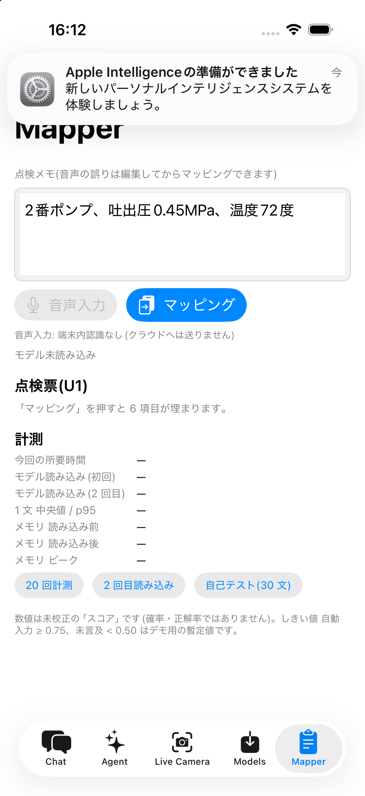
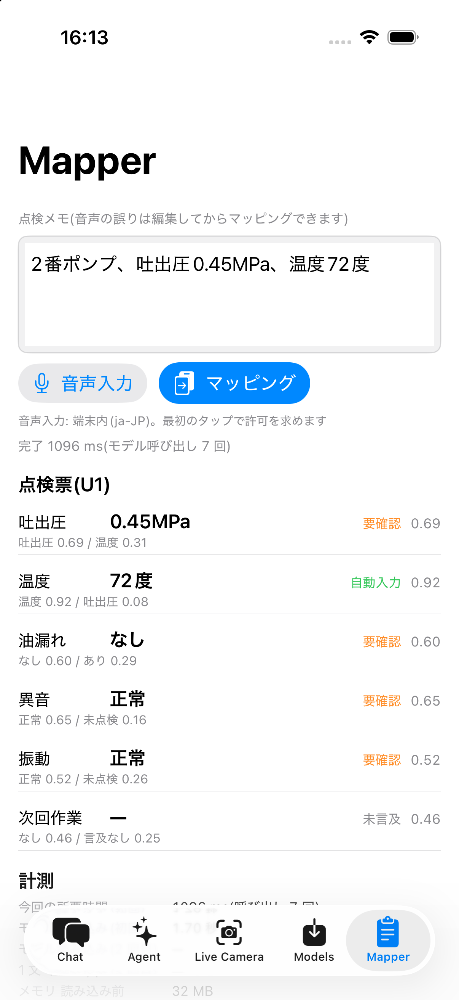
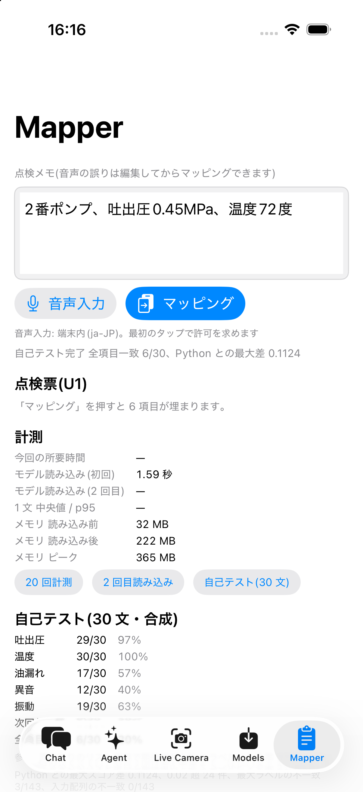

# GLiNER2.5-multi (Core ML) で日本語の点検メモを 6 項目の点検票に落とす (2026-10-04)

経営陣向けデモのために、既存の iOS DemoApp に `Mapper` 画面を 1 つ足した記録。使ったのは
[FluidInference/gliner2-5-multi-coreml](https://huggingface.co/FluidInference/gliner2-5-multi-coreml)
の**分類パッケージ 1 個だけ**(`gliner2_multi_classification_fp16_L128_K8.mlpackage`)。抽出系の
パッケージは取得も使用もしていない。モデルの変換・量子化・学習は一切していない。

このページの数字は実測値だけで、**できなかったこと(iPhone 17 Pro での計測、音声入力の実行)も
そのまま書いてある**。精度が低い項目はしきい値も文も調整せずにそのまま載せている。

## 結論(先に)

| 問い | 答え |
|---|---|
| 端末内で動くか | 動く。モデルはアプリに同梱、推論はネットワーク不要 |
| 速いか | iPhone 15 で 1 文 **中央値 111 ms**(モデル呼び出し 7 回) |
| RAM | 読み込み後 **574 MB**(読み込み前 9 MB)。ピークも同じ |
| 前処理は Python と一致するか | **する。143 呼び出し × 4 配列が完全一致**(Mac・iPhone 15 とも 0 件不一致) |
| スコアは Python と一致するか | 549 スコア中 **547 が 0.02 以内**、最大差 0.041、平均 0.0018。**最大ラベルは 143/143 で一致** |
| 精度 | 数値はほぼ完璧(温度 30/30、吐出圧 29/30)。**リスト項目は弱い**(異音 12/30)。全項目一致 6/30 |
| 何が足りないか | **「言及が無い」を言えないこと。** 順位付けは良い(期待値が上位 2 に入る率 97.4%) |

## 環境

- Mac: この作業マシン、macOS 27.0 (Darwin 27.0.0)。Xcode の `xcodebuild` / `xcrun devicectl`。
- 端末: **iPhone15(okayu) iOS 26.6.2**(`00008120-000A194E36C3A01E`)。Release ビルドを
  `devicectl` でインストールして実行。
- **iPhone17Pro(okayu) iOS 26.6.1 は計測できていない。** 作業中ずっと `devicectl list devices` で
  `unavailable`(ペアリング済み・未接続、最終接続 14:20)のままで、インストールに到達しなかった。
  主対象の端末なので、**この表の時間とメモリは iPhone 15 のものだけ**である。
- モデル: `FluidInference/gliner2-5-multi-coreml`(Apache-2.0)。`gliner2_multi_classification_fp16_L128_K8.mlpackage`
  550 MB + `tokenizer/` 15 MB。アプリは Xcode が `.mlmodelc` にコンパイルして同梱(アプリ 582 MB)。
- Python 参照: `gliner2==2.0.0`、`coremltools`、`torch 2.14.1`(CPU)、`transformers 4.57.6`。
  配布物の `preprocessing.py` / `runtime.py` をそのまま使った。

## 方式

分類パッケージ 1 個だけで 6 項目を埋める。**数値はコードで切り出し、項目の割り当てと候補の選択だけを
モデルにやらせる。**

| key | 項目 | 型 | 候補 / 単位 |
|---|---|---|---|
| discharge_pressure | 吐出圧 | number | MPa |
| temperature | 温度 | number | ℃(「度」も可) |
| oil_leak | 油漏れ | list | あり / なし |
| abnormal_sound | 異音 | list | 正常 / 異常 / 未点検 |
| vibration | 振動 | list | 正常 / 異常 / 未点検 |
| next_action | 次回作業 | list | 給油 / 交換 / 清掃 / なし |

- **リスト項目**: `labels = 候補 + ["言及なし"]`、`task = 項目名` で 1 回分類。最大が「言及なし」か
  最大スコア < 0.50 → 未言及。≥ 0.75 → 自動入力。その間 → 要確認。
- **数値項目**: 半角・全角の数字 + 小数 + 直後の単位(MPa/kPa/℃/度/mm/%)をコードで切り出し、
  候補の**前 8 文字〜後 4 文字**を `text`、`labels = ["吐出圧","温度","その他"]`、`task = "数値の項目"`
  で項目を決める。同じ項目に 2 つ付いたら後の方を採用し「要確認(訂正の可能性)」。
  かな数字(「れいてんよんご」)は対象外。
- 1 文あたりのモデル呼び出しは **リスト 4 回 + 数値候補ごと 1 回**(例文では 7 回)。
- 画面の数値は「スコア」と呼び、確率・正解率とは書かない(未校正のため)。しきい値 0.75 / 0.50 は
  **デモ用の暫定値**で、画面にもそう書いてある。

### 画面に「上位 2 ラベル」を出している理由

各項目に常に**上位 2 ラベルとスコア**を併記している(例: `言及なし 0.98 / 正常 0.01`)。
これは下の「否定が『言及なし』側に寄る」癖を実測で観察したあとに追加した表示で、
**判定ルール(自動入力／要確認／未言及)は指示どおりのまま変えていない。**
特定の文に合わせた調整ではなく、「モデルが迷っている場所を常に見せる」ための一般的な表示である。

## 前処理の一致(ここが本題だった)

`gliner2` の `SchemaTransformer` + `ExtractorCollator` が作る 4 配列を Swift で再現した。
分類 1 件の列は次のとおりで、**`[CLS]`/`[SEP]` は付かない**(`gliner2` は `tokenize()` と
`convert_tokens_to_ids()` を使うので、tokenizer の post-processor が走らない)。

```
( [P] <task> ( [L] <label0> [L] <label1> … ) ) [SEP_TEXT] <本文の語…>
```

`marker_indices` は各 `[L]` のサブワード位置。30 文 × (リスト 4 + 数値候補) = **143 呼び出し**について、
`input_ids` / `attention_mask` / `marker_indices` / `marker_mask` を Python の出力と突き合わせた。

| 実行場所 | 入力配列の不一致 | スコアの最大差 |
|---|---|---|
| Mac (`swift test`) | **0 / 143** | **0.000000**(同一 Mac・同一パッケージなので完全同値) |
| iPhone 15 (アプリ内) | **0 / 143** | 0.040807(549 スコア中 0.02 超は 2 件、平均 0.0018) |

iPhone の最大差は `数値の項目 / 温度` で device 0.7173 vs python 0.6765(本文 `温度64度、吐出圧`)。
**指示書の「差 0.02 以内」は 549 スコア中 2 件(0.4%)で満たしていない。** ただし
**最大スコアのラベルは 143 呼び出しすべてで一致**しており、この 2 件も 0.50〜0.75 の「要確認」帯の
中で動いただけなので、画面に出る判定は変わらない。ANE と Mac の fp16 演算差と考えられる
(確認はしていない)。

### 写すのに必要だった 4 点(ここで 1 日溶ける)

1. **`tokenizer_config.json` の `tokenizer_class` は `DebertaV2Tokenizer`** だが、これは
   swift-transformers 1.3.3 の登録表に無く、**フォールバックが BPE** になる(まったく別のモデル)。
   実体は SentencePiece Unigram(`tokenizer.json` の `model.type == "Unigram"`)なので、
   設定を `XLMRobertaTokenizer` に差し替えて `PreTrainedTokenizer` を直接構築した。
2. **`UnigramTokenizer.convertTokenToId` は `model.vocab`(id 0..250100)しか見ない。**
   `[P]`/`[L]`/`[SEP_TEXT]` などは `added_tokens` 側(id 250102〜250111)にいるので、黙って
   `[UNK]`=3 に落ちる。`tokenizer.json` の `added_tokens` を自前で読んで先に引く必要がある。
3. **`gliner2._collate_batch` は、末尾が `.`/`!`/`?` でない本文に「.」を足す。** 結果として
   どの列も `▁` + `.` で終わる。これを写さないと一致しない。
4. 語分割は `WhitespaceTokenSplitter` + `lower=True`。日本語は句読点で `\w+` が切れるので
   「吐出圧0.45MPa」→ `["吐出圧0", ".", "45mpa"]`(**MPa が小文字化される**)。各語を個別に
   `tokenize()` するため `▁` が語ごとに付く。

再現:

```
CORELLM_GLINER_DIR="$PWD/models/gliner2-5-multi-coreml" swift test --filter GLiNERParitySuite
```

3 本とも通る(前処理 143/143、数値窓 30 文一致、スコア差 0.02 以内)。`CORELLM_GLINER_DIR` を
設定しなければモデルを要する 2 本はスキップされる。

## 精度(30 文、しきい値も文も未調整)

10 文は依頼元の指定、20 文は同じ形式で**合成**したもの(顧客データは使っていない)。
期待値は 6 項目それぞれ「値 / 候補 / 未言及」。**期待値に合わせた調整はしていない。**

| 項目 | 一致 | 率 |
|---|---|---|
| 吐出圧 | 29/30 | 96.7% |
| 温度 | 30/30 | 100.0% |
| 油漏れ | 17/30 | 56.7% |
| 異音 | 12/30 | 40.0% |
| 振動 | 19/30 | 63.3% |
| 次回作業 | 25/30 | 83.3% |
| **全項目一致** | **6/30** | **20.0%** |

参考値(ルール変更ではなく参考の集計): **言及のあるリスト項目について、期待値が上位 2 ラベルの
どちらかに入る率は 37/38 = 97.4%。** 数値項目はラベルが項目名であって値ではないため、この集計からは
除いてある。

### 何が間違うのか

不一致 48 件の中身は、ほぼ 2 つの癖に集約される。

1. **言及が無い項目に、モデルが勝手に値を入れる(48 件のうち大半)。** しかも確信が強い。
   - 「振動が大きい」→ 異音 = **異常 1.00**(異音の言及なし)
   - 「油漏れが少し見られます」→ 異音 = **異常 1.00**、振動 = **異常 1.00**
   - 「吐出圧0.38MPa、異音が少しある」→ 油漏れ = **あり 0.99**
   1 つの不具合が、他の不具合項目へ波及する。「言及なし」ラベルを入れてあっても効かない。
2. **否定が「言及なし」側に寄る。** 「異音なし」は `正常` ではなく `言及なし` が勝つ。
   - 「異音なし、振動も問題ありません」→ 異音 = 未言及(**言及なし 0.98** / 正常 0.01)
   - 「温度は70度、異音は特にありません」→ 異音 = 未言及(言及なし 0.64 / 正常 0.23)
   日本語の「〜なし」を「その項目に触れていない」と解釈している。

副作用的な既知の問題:

3. **数値の窓(前 8 / 後 4 文字)が次の項目名を飲み込む。** 「吐出圧は0.62MPa、温度は68度」では
   `0.62` の窓が `温度` を含むため両候補が 温度 に割り当てられ、後勝ちルールで 温度 = 68
   (要確認・訂正の可能性)、**吐出圧は未言及**になる。30 文中で吐出圧を落としたのはこの 1 件。
4. 「3号機、吐出圧0.33MPa」は `3` と `0.33` の両方が 吐出圧 と判定され、後勝ちで値は正しい
   (0.33)が「訂正の可能性」が付く。

### うまくいくこと

- **数値の切り出しと項目割り当て**: 温度 30/30、吐出圧 29/30。
- **訂正を拾う**(難例として挙がっていたもの): 「圧力0.45、違った、0.54MPa」→
  吐出圧 = **0.54**(要確認・訂正の可能性)。後勝ちルールが効いた。
- **言い換え**(難例): 「次回グリスアップ予定」→ 次回作業 = **給油 0.82**。
  「フィルター清掃を次回実施」→ **清掃 0.99**。「次回は部品交換の予定」→ **交換 1.00**。
  「温度は55度、次回はグリス給油」→ **給油 1.00**。
- **明示的に全部言った文**は 6/6 埋まる: 「吐出圧0.7MPa、温度80度、油漏れなし、異音正常、振動正常、次回清掃」。

## 時間とメモリ(iPhone 15、Release)

| 項目 | 値 |
|---|---|
| モデル読み込み(初回) | **7.70 s** |
| モデル読み込み(2 回目、同一プロセス) | 2.01 s |
| 1 文の所要時間(20 回、モデル呼び出し 7 回) | **中央値 111.3 ms / p95 118.2 ms**(min 105.3 / max 118.8) |
| メモリ 読み込み前 | 9.0 MB |
| メモリ 読み込み後 | **573.7 MB** |
| メモリ ピーク | 573.7 MB |

`phys_footprint`(`task_info` / `TASK_VM_INFO`)。計測文は「2番ポンプ、吐出圧0.45MPa、温度72度」。
**iPhone 17 Pro の対応する数字は無い**(端末に到達できなかった)。

生ログ: [`2026-10-04-gliner25-mapper-demo/selftest-iphone15.log`](2026-10-04-gliner25-mapper-demo/selftest-iphone15.log)
(30 文それぞれの全項目の出力・スコアつき)。

## 音声入力とオフライン

- 実装は `SFSpeechRecognizer(locale: ja-JP)` + **`requiresOnDeviceRecognition = true`**。
  `supportsOnDeviceRecognition` が false なら画面に「端末内認識なし」と出してボタンを無効化し、
  **クラウド認識へは落とさない**。確定結果だけを入力欄に入れ、**編集してからマッピングできる**
  (音声の誤りをモデルの失敗に見せないため)。`Info.plist` に
  `NSSpeechRecognitionUsageDescription` と `NSMicrophoneUsageDescription` を追加した。
- **実機での音声入力は実行できていない。** ヘッドレス実行では権限ダイアログが出せず、
  自己テストの出力は `speech: 音声入力: 権限待ち` のまま。実際に試すには画面を一度開いて
  マイクと音声認識を許可する操作(人の手)が必要。権限は画面を開いた瞬間ではなく
  **音声入力ボタンの最初のタップで**求める(開いただけでダイアログが出ないように変えた)。
- **機内モード + Wi-Fi オフでの確認も未実施**(同じ理由)。ただし Mapper の推論側は
  **モデルとトークナイザをアプリに同梱**しており、ネットワークを一切使わない。自己テスト 30 文が
  端末上で完走していることが、推論がオフラインで動くことの実測の裏付けである。音声認識だけは
  上記フラグで端末内に固定してある。

## 画面

| | |
|---|---|
|  |  |
| 初期状態。音声入力は「端末内認識なし」でボタンが無効 | マッピング後。値・状態・スコアと**上位 2 ラベル** |



UI のスクリーンショットは **iOS シミュレータ**(iPhone 17 Pro, iOS 26)で撮った。実機には
`devicectl` にスクリーンショット機能がなく、libimobiledevice も入っていないため。
**上の表の時間・メモリ・一致の数字はすべて実機 (iPhone 15) のもので、シミュレータの値は使っていない。**

スクリーンショット内の数値はシミュレータ(CPU 実行)のものなので、本文の実機の数字とは違う。
とくに自己テスト画面に出ている一致の行は **シミュレータの値(最大差 0.1124、0.02 超 24 件、
最大ラベルの不一致 3/143)**で、実機 (ANE) の **0.0408 / 2 件 / 0 件** より悪い。入力配列の
不一致はどちらも 0/143。**項目別の一致率はシミュレータと実機で完全に同じ**
(吐出圧 29/30、温度 30/30、油漏れ 17/30、異音 12/30、振動 19/30、次回作業 25/30)で、
演算環境が変わっても結論は動かないことの傍証になっている。

1 枚目で音声入力が「端末内認識なし(クラウドへは送りません)」と出てボタンが無効になっているのは、
シミュレータに ja-JP の端末内認識が無いため。**仕様どおりクラウドに落ちない**ことがそのまま見えている。

## 再現手順

```
# 1. モデル(分類パッケージだけ)
hf download FluidInference/gliner2-5-multi-coreml \
  --include "gliner2_multi_classification_fp16_L128_K8.mlpackage/*" "tokenizer/*" \
            "config.json" "preprocessing.py" "runtime.py" "README.md" \
  --local-dir models/gliner2-5-multi-coreml

# 2. Mac 側の一致テスト
CORELLM_GLINER_DIR="$PWD/models/gliner2-5-multi-coreml" swift test --filter GLiNERParitySuite

# 3. 実機の Release ビルドとインストール
cd Examples/DemoApp && xcodegen generate
xcodebuild -project DemoApp.xcodeproj -scheme DemoApp-iOS -configuration Release \
  -destination 'generic/platform=iOS' -derivedDataPath /tmp/dd build
xcrun devicectl device install app --device <UDID> /tmp/dd/Build/Products/Release-iphoneos/DemoApp.app

# 4. 端末で自己テストと計測(ヘッドレス)
xcrun devicectl device process launch --console --terminate-existing \
  --device <UDID> com.coreml-llm-samples.DemoApp --mapper-selftest
```

`models/` は gitignore されているので、クローン直後は手順 1 が必要。`project.yml` は
`.mlpackage` と `tokenizer/` を `optional: true` で参照しているため、モデルが無くても
アプリ自体はビルドできる(Mapper 画面だけが読み込みに失敗する)。

Python 側のフィクスチャ生成器は作業用スクラッチに置いた(`gen_fixtures.py`)。30 文と期待値の
正本はそれで、出力が `Examples/DemoApp/DemoApp/Demos/Mapper/Fixtures/gliner_parity.json`。

## 足した 20 文

11〜30 が合成。括弧内が期待値(言及のある項目だけ)。

| # | 文 | 期待値 |
|---|---|---|
| 11 | 吐出圧は0.62MPa、温度は68度 | 吐出圧 0.62、温度 68 |
| 12 | 油漏れなし、異音なし | 油漏れ なし、異音 正常 |
| 13 | 振動は正常、次回は清掃 | 振動 正常、次回作業 清掃 |
| 14 | 温度は91度で高め、油漏れあり | 温度 91、油漏れ あり |
| 15 | 吐出圧0.38MPa、異音が少しある | 吐出圧 0.38、異音 異常 |
| 16 | 次回は部品交換の予定 | 次回作業 交換 |
| 17 | 異音は未点検、振動も未点検 | 異音 未点検、振動 未点検 |
| 18 | 温度64度、吐出圧0.41MPa、異音なし | 温度 64、吐出圧 0.41、異音 正常 |
| 19 | 油漏れが少し見られます | 油漏れ あり |
| 20 | 振動問題なし、次回給油 | 振動 正常、次回作業 給油 |
| 21 | 吐出圧0.55MPa | 吐出圧 0.55 |
| 22 | 温度78度、振動が大きめ | 温度 78、振動 異常 |
| 23 | 油漏れは確認できませんでした | 油漏れ なし |
| 24 | 次回作業は特にありません | 次回作業 なし |
| 25 | 異音あり、振動あり、油漏れあり | 異音 異常、振動 異常、油漏れ あり |
| 26 | 温度は55度、次回はグリス給油 | 温度 55、次回作業 給油 |
| 27 | 吐出圧0.7MPa、温度80度、油漏れなし、異音正常、振動正常、次回清掃 | 6 項目すべて |
| 28 | 3号機、吐出圧0.33MPa | 吐出圧 0.33 |
| 29 | 温度は70度、異音は特にありません | 温度 70、異音 正常 |
| 30 | 振動は未点検、吐出圧0.48MPa、油漏れなし | 振動 未点検、吐出圧 0.48、油漏れ なし |

## 既知の問題 / やっていないこと

- **iPhone 17 Pro での計測なし。** 主対象端末に到達できなかった。
- **音声入力と機内モードの実機確認なし。** 人の操作が必要。
- 上の「何が間違うのか」1〜4。とくに 1(言及の無い項目を埋める)は、この構成のままでは直らない。
  しきい値を上げれば誤入力は減るが、同時に正しい自動入力も落ちる(スコアが 0.5〜0.7 に集まっている
  ため)。**必要なのは「言及の有無」を別に判定する層**で、これは分類ヘッド 1 個の外側の問題。
- 画像入力(写真 → Vision OCR → 入力欄)は未着手(ストレッチ扱い)。
- しきい値 0.75 / 0.50 は根拠のある値ではない。校正していない。
- 30 文のうち 20 文は合成。実地の文ではないので、この一致率は実運用の精度ではない。
